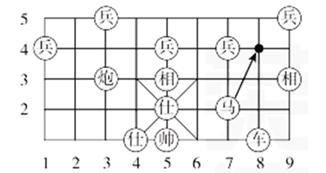

# Mathematics (Grade 3)

**ID**: da6aeb70
**难度**: medium
**题型**: multiple_choice

## 题目
象棋有规定：马走日(如图)。如果要走一步马，你认为走到的位置不可能是(  )。

A．(6，4)
B．(5，1)
C．(6，3)

## 解答

**答案**: C

1. Step1:明确马走日的规则，观察图中马当前位置为(7,2)。
2. Step2:根据马走日的走法，逐一分析选项。对于A选项(6,4)，从(7,2)走日字可以到达。
3. Step3:对于B选项(5,1)，从(7,2)走日字也可以到达。
4. Step4:对于C选项(6,3)，按照马走日的规则，从(7,2)无法一步走到。
5. Step5:所以走到的位置不可能是C选项(6,3)。

## 知识点

**知识点**:
  - 

---
