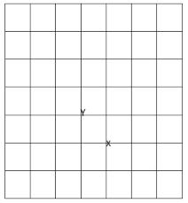

# Mathematics (Grade 3)

**ID**: e38d3a75
**难度**: medium
**题型**: multiple_choice

## 题目
如下图，如果点X的位置表示为（4 ，1），则点Y的位置可以表示为（  ）。

$\begin{description}
\item A．( 3 ，2 )\item B．( 6 , 2 )\item C．( 4 , 3 )\item D．( 2 ,  5)
\end{description}$

## 解答

**答案**: A

1. Step1:已知点X的位置表示为（4 ，1），说明在该坐标表示中，第一个数代表列数，第二个数代表行数。
2. Step2:观察图形，点Y在第3列，第2行。
3. Step3:按照前面的坐标表示规则，点Y的位置应表示为(3, 2)，所以答案是A。

## 知识点

**知识点**:
  - 

---
