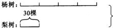

# Mathematics (Grade 3)

**ID**: e41dd13e
**难度**: medium
**题型**: multiple_choice

## 题目
（  ）棵．
A．90
B．120
C．150
D．无法计算

## 解答

**答案**: C

1. Step1:根据图意，确定把梨树的棵数看作单位‘1’，且杨树的棵数相当于梨树的4倍
2. Step2:计算杨树和梨树的总棵数相当于梨树的倍数，即1 + 4 = 5倍
3. Step3:已知梨树有30棵，计算杨树和梨树的总棵数，为30×5 = 150棵
4. Step4:从选项中选择正确答案，即C选项

## 知识点

**知识点**:
  - 图文应用题．

---
