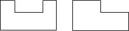

# Mathematics (Grade 3)

**ID**: e8278ffa
**难度**: medium
**题型**: multiple_choice

## 题目
如右图，这两个图形（   ）。

A．周长相等，面积相等。
B．周长相等，面积不等。
C．周长不等，面积相等。

## 解答

**答案**: C

1. Step1:观察左图，将其凹进去部分的水平线段向上平移，竖直线段向右平移，可得其周长与相同长和宽的长方形周长相等
2. Step2:观察右图，其为规则的长方形，周长也是相同长和宽的长方形周长，所以两个图形周长相等
3. Step3:左图的面积是相同长和宽的长方形面积减去凹进去部分的面积，右图面积就是该长方形的面积，所以左图面积小于右图面积，即两个图形面积不等
4. Step4:综合前面结论，可知两个图形周长相等，面积不等，答案选B

## 知识点

**知识点**:
  - 小学数学;图形与几何;平面图形

---
