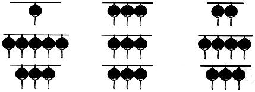

# Mathematics (Grade 3)

**ID**: ed28e44c
**难度**: medium
**题型**: multiple_choice

## 题目
把9个灯笼挂在3根绳子上，下面哪种挂法是平均分？在(    )里画“√”。

（_____）         （_____）           （______）

## 解答

**答案**: B

1. Step1:明确平均分的概念，即每份的数量相等。
2. Step2:分析第一组灯笼，数量分别为1、3、2，每份数量不相等，不是平均分。
3. Step3:分析第二组灯笼，每根绳子上都是3个灯笼，每份数量相等，是平均分。
4. Step4:分析第三组灯笼，数量分别为4、3、2，每份数量不相等，不是平均分。
5. Step5:得出第二组挂法是平均分，对应答案为B。

## 知识点

**知识点**:
  - 

---
