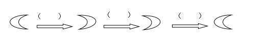

# Mathematics (Grade 3)

**ID**: ef5d5ced
**难度**: medium
**题型**: multiple_choice

## 题目
观察下图，判断图形从左到右依次发生了怎样的变化？把合适的选项填在下面的括号里。（   ）

A．旋转，平移 ，旋转
B．旋转，旋转，平移

## 解答

**答案**: A

1. Step1:观察第一个图形到第二个图形，图形的方向发生了改变，这种变化符合旋转的特征，所以第一个变化是旋转
2. Step2:观察第二个图形到第三个图形，图形同样是方向发生了改变，属于旋转现象，所以第二个变化是旋转
3. Step3:观察第三个图形到第四个图形，图形的形状、大小和方向都没有改变，只是位置发生了移动，这是平移的特征，所以第三个变化是平移

## 知识点

**知识点**:
  - 小学数学;图形与几何;图形与变换;平移与平移现象;旋转与旋转现象

---
