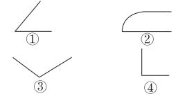

# Mathematics (Grade 3)

**ID**: f1a25964
**难度**: medium
**题型**: multiple_choice

## 题目
下面图形中，（）是直角。

## 解答

**答案**: ④

1. Step1:明确直角的定义为等于90°的角
2. Step2:观察图形①，判断其角度小于90°，不是直角
3. Step3:观察图形②，其为曲线，不是角，更不是直角
4. Step4:观察图形③，判断其角度大于90°，不是直角
5. Step5:观察图形④，其为90°的角，是直角

## 知识点

**知识点**:
  - 角的认识

---
