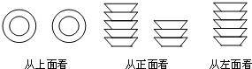

# Mathematics (Grade 3)

**ID**: f371b9a5
**难度**: medium
**题型**: multiple_choice

## 题目
桌子上摆着若干个碟子，从三个方向看如图所示，则这张桌子上共有碟子(  )
A．6个
B．8个
C．12个

## 解答

**答案**: B

1. Step1:观察从上面看到的图形，可知碟子摆放有两行
2. Step2:观察从正面看到的图形，能得出左边一行有5个碟子
3. Step3:同样从正面看到的图形可知，右边一行有3个碟子
4. Step4:将左右两行碟子数相加，即5 + 3 = 8个，得到碟子总数

## 知识点

**知识点**:
  - 从不同方向观察物体和几何体．

---
