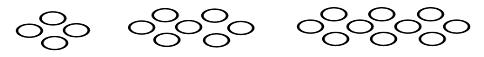

# Mathematics (Grade 3)

**ID**: f468932b
**难度**: medium
**题型**: multiple_choice

## 题目
观察下列图形的构成规律，按此规律，第10个图形中棋子的个数为（    ）

$\begin{description}
\item A．51\item B．45\item C．42\item D．31
\end{description}$

## 解答

**答案**: D

1. Step1:观察第一个图形，棋子个数为4 = 3×1 + 1
2. Step2:观察第二个图形，棋子个数为7 = 3×2 + 1
3. Step3:观察第三个图形，棋子个数为10 = 3×3 + 1
4. Step4:总结规律，第n个图形中棋子的个数为3n + 1
5. Step5:当n = 10时，计算棋子个数为3×10 + 1 = 31
6. Step6:得出答案为D

## 知识点

**知识点**:
  - 小学数学;探索规律;图形的变化规律

---
