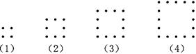

# Mathematics (Grade 3)

**ID**: fa2a83b7
**难度**: medium
**题型**: multiple_choice

## 题目
明明用石子摆出了图中的图案，根据规律判断第6个图案中石子总数为(  )。

A．12
B．16
C．20
D．24

## 解答

**答案**: D

1. Step1:观察图案，第一个图案有4个石子，可看作4×1；第二个图案有8个石子，可看作4×2；第三个图案有12个石子，可看作4×3；第四个图案有16个石子，可看作4×4。
2. Step2:总结规律，第n个图案的石子总数为4×n。
3. Step3:求第6个图案的石子总数，将n = 6代入规律式子，即4×6 = 24。

## 知识点

**知识点**:
  - 小学数学;探索规律;图形的变化规律

---
