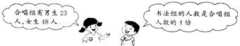

# Mathematics (Grade 3)

**ID**: 0414e053
**难度**: medium
**题型**: short_answer

## 题目
同学们参加特长培训班．
书法组有多少人？

## 解答

**答案**: 164

1. Step1:先计算合唱组的人数，合唱组男生23人，女生18人，所以合唱组人数为23 + 18 = 41人
2. Step2:已知书法组的人数是合唱组人数的4倍，所以书法组人数为41×4 = 164人

## 知识点

**知识点**:
  - 整数、小数复合应用题．

---
