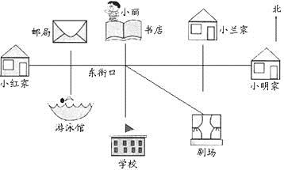

# Mathematics (Grade 3)

**ID**: 0ab05824
**难度**: medium
**题型**: short_answer

## 题目
说一说，图中假如小丽从剧场出发，要到游泳馆，可以怎样走？ 

## 解答

**答案**: 第一种走法：小丽从剧场出发，先向西北走东街口，再向西走，最后向南走到游泳馆。, 第二种走法：小丽从剧场出发，先向北走，再向西走，最后向南走到游泳馆

1. Step1:明确小丽的起始位置是剧场，目标位置是游泳馆
2. Step2:确定第一种走法，即从剧场出发，先向西北走到东街口，接着向西走，最后向南走到游泳馆
3. Step3:确定第二种走法，即从剧场出发，先向北走，再向西走，最后向南走到游泳馆

## 知识点

**知识点**:
  - 小学数学;图形与几何;位置与方向;路线图

---
