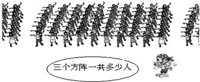

# Mathematics (Grade 3)

**ID**: 1071e177
**难度**: medium
**题型**: short_answer

## 题目
学校举行团体操表演，每个方阵有8行，每行10人．

## 解答

**答案**: 240

1. Step1:先计算每个方阵的人数，因为每个方阵有8行，每行10人，根据乘法原理，每个方阵人数为10×8 = 80人
2. Step2:再计算3个方阵的总人数，已知每个方阵80人，所以3个方阵总人数为80×3 = 240人

## 知识点

**知识点**:
  - 整数、小数复合应用题．

---
