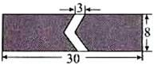

# Mathematics (Grade 3)

**ID**: 10f0192e
**难度**: medium
**题型**: short_answer

## 题目
如图，一块长方形绿地中有一条弯曲的小路，准备在小路的两侧铺上草坪。草坪的面积是多少平方米？（单位：米）

## 解答

**答案**: 216平方米

1. Step1:分析可知，草坪的面积实际是长为(30 - 3)米、宽8米的长方形的面积
2. Step2:先计算长，30 - 3 = 27米
3. Step3:根据长方形面积公式，面积 = 长×宽，即27×8
4. Step4:计算27×8 = 216平方米

## 知识点

**知识点**:
  - 小学数学;图形与几何

---
