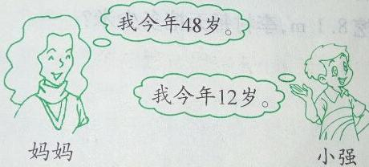

# Mathematics (Grade 3)

**ID**: 12632b98
**难度**: medium
**题型**: short_answer

## 题目

 妈妈  我今年48岁  小强  我今年12岁
 再过多少年妈妈的年龄是小强的3倍？

## 解答

**答案**: 6

1. Step1:设再过x年妈妈的年龄是小强的3倍
2. Step2:根据x年后妈妈年龄是小强的3倍列出方程(12 + x)×3 = 48 + x
3. Step3:展开方程左边得到3x + 36 = 48 + x
4. Step4:将含x的项移到一边，常数项移到另一边，得到3x - x = 48 - 36
5. Step5:计算得出2x = 12
6. Step6:求解x，两边同时除以2，得到x = 6

## 知识点

**知识点**:
  - --

---
