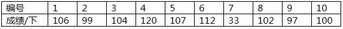

# Mathematics (Grade 3)

**ID**: 12a61fe6
**难度**: medium
**题型**: short_answer

## 题目
下面是四年级一班10个女生一分钟跳绳成绩记录单： 

这组数据的中位数是多少？

## 解答

**答案**: 103

1. Step1:将这10个数据33、97、99、100、102、104、106、107、112、120按照从小到大的顺序排列为33  97  99  100  102  104  106  107  112  120
2. Step2:因为数据个数10为偶数，所以中位数是第5个和第6个数据的平均数
3. Step3:找出第5个数据是102，第6个数据是104
4. Step4:计算（102+104）÷2=103得到中位数

## 知识点

**知识点**:
  - 小学数学;统计和概率;统计;平均数、中位数、众数

---
