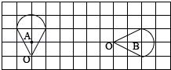

# Mathematics (Grade 3)

**ID**: 1377d288
**难度**: medium
**题型**: short_answer

## 题目
说一说如图中图形A是怎样变换得到图形B的．

## 解答

**答案**: 以O为中心，先顺时针旋转90°，再向右平移6个格、向上平移1个格得到B.

1. Step1:观察图形A和图形B，发现图形的形状和大小没有改变，只是位置发生了变化，判断是通过旋转和平移得到的。
2. Step2:确定图形变换的中心点为O。
3. Step3:明确图形A先以O为中心顺时针旋转90°。
4. Step4:确定旋转后再将图形向右平移6个格。
5. Step5:最后将图形向上平移1个格得到图形B。

## 知识点

**知识点**:
  - 

---
