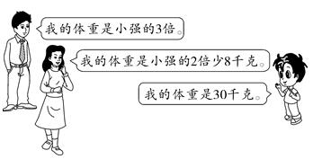

# Mathematics (Grade 3)

**ID**: 19cf7f36
**难度**: medium
**题型**: short_answer

## 题目
你知道小强的爸爸、妈妈的体重各是多少千克吗？ 

## 解答

**答案**: 90, 52

1. Step1:已知小强体重为30千克，根据爸爸体重是小强的3倍，可得爸爸体重为30×3 = 90千克
2. Step2:已知小强体重为30千克，根据妈妈体重是小强的2倍少8千克，可得妈妈体重为30×2 - 8 = 52千克

## 知识点

**知识点**:
  - 小学数学;数与代数;应用题;复合应用题;整数四则复合应用题

---
