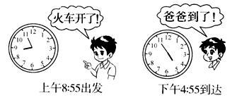

# Mathematics (Grade 3)

**ID**: 1c8740c4
**难度**: medium
**题型**: short_answer

## 题目
爸爸坐火车从甲站到乙站，甲站到乙站的铁路线长960千米。

（1）爸爸从甲站到乙站一共用了多少小时？
（2）这列火车平均每小时可以行多少千米？

## 解答

**答案**: 8小时, 120千米

1. Step1:将下午4:55转换为24小时制为16:55
2. Step2:用到达时间16:55减去出发时间8:55，16时55分 - 8时55分 = 8小时，得出爸爸从甲站到乙站一共用的时间
3. Step3:已知铁路线长960千米，所用时间为8小时，根据速度=路程÷时间，960÷8 = 120千米，得出这列火车平均每小时行驶的千米数

## 知识点

**知识点**:
  - 小学数学;数与代数;常见的量;时间单位及换算;经过时间的计算;应用题;常见的数学问题;行程问题

---
