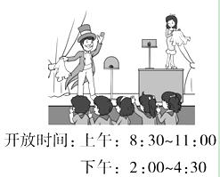

# Mathematics (Grade 3)

**ID**: 1edd3c75
**难度**: medium
**题型**: short_answer

## 题目
生活中的数学。

(1)上午马戏团开放多长时间？
(2)下午马戏团开放多长时间？

## 解答

**答案**: 2时30分, 2时30分

1. Step1:计算上午开放时间，用上午结束时间11时减去开始时间8时30分，当被减数的“分”不够减时，从“时”位借1时当60分，11时变为10时60分，10时60分 - 8时30分 = 2时30分
2. Step2:计算下午开放时间，用下午结束时间4时30分减去开始时间2时，4时30分 - 2时 = 2时30分

## 知识点

**知识点**:
  - 小学数学;数与代数;常见的量;时间单位及换算

---
