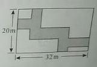

# Mathematics (Grade 3)

**ID**: 23aae0e5
**难度**: medium
**题型**: short_answer

## 题目
在如图所示的长方形草坪上，要修筑两条同样宽的“之”字形柏油路，路宽为2米，则剩余草坪的面积是多少平方米？ （长方形的长32米，宽20米）

## 解答

**答案**: 540

1. Step1:计算两条路的面积之和，其中横向路的面积为2×20平方米，纵向路的面积为2×32平方米，由于两条路交叉部分（2×2平方米）被重复计算了一次，所以路的总面积为2×20 + 2×32 - 2×2 = 100平方米
2. Step2:计算长方形草坪的总面积，根据长方形面积公式，长为32米，宽为20米，总面积为32×20 = 640平方米
3. Step3:用长方形草坪的总面积减去路的总面积，得到剩余草坪的面积为640 - 100 = 540平方米

## 知识点

**知识点**:
  - 

---
