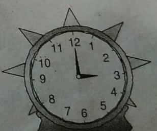

# Mathematics (Grade 3)

**ID**: 267923f5
**难度**: medium
**题型**: short_answer

## 题目
钟表的分针从一个数走到相邻的另一个数是5分钟，为了使看时间更准确，一些钟表将每两个数之间在平均分为5小格，并用点隔开.请你认真观察下图的这个钟表，如果把每两个数之间都用点隔开，一共需要加多少个点？

## 解答

**答案**: 60

1. Step1:明确钟表有12个大格
2. Step2:因为每两个数（即每一个大格）之间平均分为5小格
3. Step3:所以用大格数12乘以每个大格包含的小格数5，即12×5
4. Step4:计算得出12×5=60，也就是一共有60个小格，每两个小格之间用点隔开，所以需要加60个点

## 知识点

**知识点**:
  - --

---
