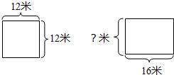

# Mathematics (Grade 3)

**ID**: 27a14074
**难度**: medium
**题型**: short_answer

## 题目
学校有两块面积相等的试验田，一块正方形，一块长方形（如图）．长方形试验田的宽是多少米？

## 解答

**答案**: 9

1. Step1:根据正方形面积公式S = a×a（a为边长），已知正方形试验田边长为12米，可计算其面积为12×12 = 144平方米
2. Step2:因为两块试验田面积相等，所以长方形试验田面积也是144平方米
3. Step3:根据长方形面积公式S = a×b（a为长，b为宽），已知长方形试验田长为16米，面积为144平方米，求宽b = S÷a，即144÷16 = 9米

## 知识点

**知识点**:
  - 长方形、正方形的面积．

---
