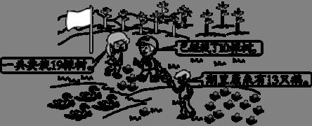

# Mathematics (Grade 3)

**ID**: 2c7c782c
**难度**: medium
**题型**: short_answer

## 题目
根据下图中的信息，提出一个用加法计算的问题和一个用减法计算的问题，并解答。

## 解答

**答案**: 12＋1＋4＝17(朵), 19－10＝9(棵)

1. Step1:观察图片获取信息，已知已经栽了10棵树，一共要栽19棵树，有12朵大花、1朵小花和4朵稍大的花
2. Step2:提出用加法计算的问题‘一共有多少朵花？’，因为有三种不同类型的花，所以将它们的数量相加，即12 + 1 + 4 = 17(朵)
3. Step3:提出用减法计算的问题‘还要栽多少棵树？’，用总共要栽的树的数量减去已经栽的树的数量，即19 - 10 = 9(棵)

## 知识点

**知识点**:
  - 小学数学;数与代数;应用题;常见的数学问题;“提问题”“填条件”问题;简单应用题;整数简单应用题

---
