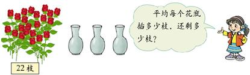

# Mathematics (Grade 3)

**ID**: 38cc5138
**难度**: medium
**题型**: short_answer

## 题目
解决问题：

## 解答

**答案**: 7, 1

1. Step1:明确问题是求22枝花平均分到3个花瓶里，每个花瓶插多少枝以及剩余多少枝
2. Step2:根据求一个数里面有几个另一个数用除法的原则，列出算式22÷3
3. Step3:计算22÷3的结果，商为7，余数为1
4. Step4:得出平均每个花瓶插7枝，还剩1枝，提取答案为7和1

## 知识点

**知识点**:
  - 有余数的除法应用题．

---
