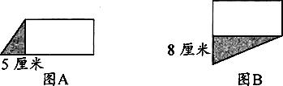

# Mathematics (Grade 3)

**ID**: 3a70f60e
**难度**: medium
**题型**: short_answer

## 题目
有一个长方形，如果一条长边增加5厘米，宽不变，面积增加25平方厘米(如图A)；如果一条宽边增加8厘米，长不变，面积增加64平方厘米(如图B)．这个长方形的面积是多少平方厘米？

## 解答

**答案**: 160平方厘米

1. Step1:根据图A，增加的部分是一个长方形，其面积为25平方厘米，长为5厘米，由长方形面积公式S = a×b（S是面积，a是长，b是宽），可得原长方形的宽为25÷5 = 5厘米
2. Step2:根据图B，增加的部分是一个长方形，其面积为64平方厘米，宽为8厘米，由长方形面积公式可得原长方形的长为64÷8 = 8厘米
3. Step3:根据长方形面积公式，原长方形面积为长×宽，即8×5 = 40平方厘米

## 知识点

**知识点**:
  - 

---
