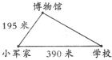

# Mathematics (Grade 3)

**ID**: 3ab15ffc
**难度**: medium
**题型**: short_answer

## 题目
如图，小军从家出发，6分钟后到了学校，照这样的速度，从学校到博物馆需要5分钟，博物馆到学校有多少米？

## 解答

**答案**: 325

1. Step1:根据图可知小军家到学校的路程是390米，时间是6分钟，由速度=路程÷时间，可得小军的速度为390÷6 = 65（米/分钟）
2. Step2:已知从学校到博物馆需要5分钟，根据路程=速度×时间，此时速度为65米/分钟，时间为5分钟，所以学校到博物馆的路程为65×5 = 325米

## 知识点

**知识点**:
  - 简单的行程问题．

---
