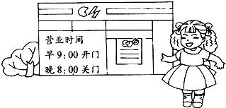

# Mathematics (Grade 3)

**ID**: 3ce8260e
**难度**: medium
**题型**: short_answer

## 题目
这家超市一天营业几个小时？

## 解答

**答案**: 11

1. Step1:将晚上8:00转化为24时计时法，即8时+12时=20时
2. Step2:用营业结束时间20时减去营业开始时间9时，即20时-9时=11时
3. Step3:得出这家超市一天营业11小时，答案为['11']

## 知识点

**知识点**:
  - 时、分、秒及其关系、单位换算与计算．

---
