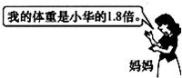

# Mathematics (Grade 3)

**ID**: 3eb33582
**难度**: medium
**题型**: short_answer

## 题目
小华的体重是30.5kg，妈妈的体重是多少千克？

## 解答

**答案**: 54.9

1. Step1:明确已知条件，小华的体重是30.5kg，妈妈体重是小华的1.8倍
2. Step2:根据乘法的意义，求妈妈体重需用小华的体重30.5kg乘1.8
3. Step3:计算30.5×1.8的结果为54.9kg，得到妈妈的体重

## 知识点

**知识点**:
  - 整数、小数复合应用题．

---
