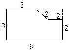

# Mathematics (Grade 3)

**ID**: 413dd845
**难度**: medium
**题型**: short_answer

## 题目
求周长．（单位：厘米）

## 解答

**答案**: 18

1. Step1:明确图形周长的计算方法为将组成图形的每条线段长度相加
2. Step2:找出图形中各线段的长度分别为3厘米、3厘米、6厘米、2厘米、2厘米、2厘米
3. Step3:将各线段长度相加，即3+3+6+2+2+2
4. Step4:计算得出结果为18厘米

## 知识点

**知识点**:
  - 长方形的周长

---
