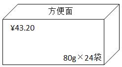

# Mathematics (Grade 3)

**ID**: 4194e575
**难度**: medium
**题型**: short_answer

## 题目
笑笑在超市买了一箱方便面（如下图所示），请你算一算一袋方便面多少元？

 ¥43.20
 80g×24袋

## 解答

**答案**: 1.8

1. Step1:明确已知条件，一箱方便面总价是43.2元，一箱有24袋。
2. Step2:根据单价=总价÷数量的公式，确定用43.2除以24来计算一袋方便面的价格。
3. Step3:计算43.2÷24的结果为1.8元。

## 知识点

**知识点**:
  - --

---
