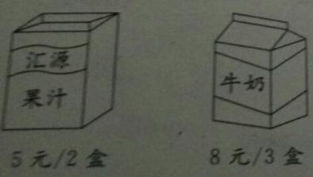

# Mathematics (Grade 3)

**ID**: 463aabdc
**难度**: medium
**题型**: short_answer

## 题目
妈妈买了5盒汇源果汁和6盒牛奶，应付多少元钱？

 5元/2盒         8元/3盒

## 解答

**答案**: 28.5

1. Step1:计算每盒汇源果汁的价格，5÷2 = 2.5（元）
2. Step2:计算5盒汇源果汁的总价，2.5×5 = 12.5（元）
3. Step3:计算每盒牛奶的价格，8÷3 = 8/3（元）
4. Step4:计算6盒牛奶的总价，(8/3)×6 = 16（元）
5. Step5:计算购买5盒汇源果汁和6盒牛奶的总价，12.5 + 16 = 28.5（元）

## 知识点

**知识点**:
  - --

---
