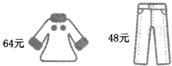

# Mathematics (Grade 3)

**ID**: 48b90172
**难度**: medium
**题型**: short_answer

## 题目
5套这样的服装共多少钱？

## 解答

**答案**: 560

1. Step1:计算一套服装的价格，即上衣价格64元加上裤子价格48元，64 + 48 = 112元
2. Step2:计算5套服装的总价，用一套服装的价格112元乘以数量5，112×5 = 560元

## 知识点

**知识点**:
  - 整数、小数复合应用题．

---
