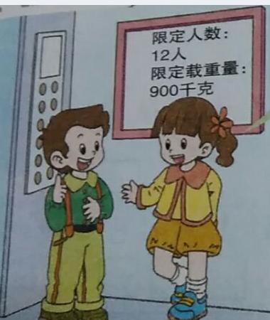

# Mathematics (Grade 3)

**ID**: 58936ac1
**难度**: medium
**题型**: short_answer

## 题目
电梯限定人数12人，限定载重量00千克，若上满12人，平均每个人的体重不能超过多少千克？

## 解答

**答案**: 75

1. Step1:明确已知条件，电梯限定人数为12人，限定载重量为900千克
2. Step2:根据平均重量 = 总载重量÷人数的公式，可知需用900除以12来计算
3. Step3:计算900÷12的结果为75千克，即平均每个人的体重不能超过75千克

## 知识点

**知识点**:
  - --

---
