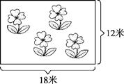

# Mathematics (Grade 3)

**ID**: 5b38edbd
**难度**: medium
**题型**: short_answer

## 题目
利民小区有一个花园(如下图)。

(1)这个花园的占地面积是多少平方米？
(2)如果每平方米种3株花，这个花园可以种多少株花？

## 解答

**答案**: 216, 648

1. Step1:根据长方形面积公式，花园为长方形，长18米，宽12米，面积为18×12 = 216平方米，得出花园占地面积
2. Step2:已知每平方米种3株花，花园面积是216平方米，种花数量为3×216 = 648株

## 知识点

**知识点**:
  - 小学数学;数与代数;应用题;复合应用题

---
