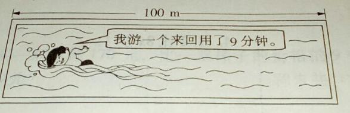

# Mathematics (Grade 3)

**ID**: 5bc06925
**难度**: medium
**题型**: short_answer

## 题目

 小明在一个100m的泳池中游一个来回用了9分钟，小明平均每分钟游多少米?（得数保留两位小数）.

## 解答

**答案**: 22.22

1. Step1:明确一个来回的距离，一个来回是泳池长度的 2 倍，即 100×2 = 200 米
2. Step2:根据速度 = 路程÷时间的公式，已知路程为 200 米，时间是 9 分钟，所以速度为 200÷9
3. Step3:计算 200÷9 的结果，并保留两位小数，得到 22.22 米

## 知识点

**知识点**:
  - --

---
