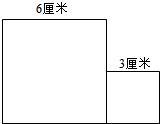

# Mathematics (Grade 3)

**ID**: 5e282810
**难度**: medium
**题型**: short_answer

## 题目
一个边长是6厘米的正方形和一个边长3厘米的正方形平成的图形的周长是多少？

## 解答

**答案**: 30（厘米）

1. Step1:明确大正方形边长为6厘米，其有4条边长为6厘米的边，根据正方形周长计算方法，这4条边的长度总和为6×4厘米。
2. Step2:明确小正方形边长为3厘米，在拼成的图形中，小正方形只有2条边参与构成图形周长，这2条边的长度总和为3×2厘米。
3. Step3:将大正方形4条边的长度总和与小正方形2条边的长度总和相加，即6×4 + 3×2 ，先计算乘法6×4=24，3×2=6，再计算加法24+6得到30厘米，此即为拼成图形的周长。

## 知识点

**知识点**:
  - 长方形的周长；正方形的周长．

---
