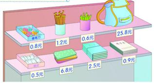

# Mathematics (Grade 3)

**ID**: 626f7798
**难度**: medium
**题型**: short_answer

## 题目

（1）买两个练习本多少钱？
（2）小东有2元钱，能买什么东西？
（3）你还能提出哪些问题？

## 解答

**答案**: 1.8, 答案不唯一, 答案不唯一

1. Step1:根据题目可知一个练习本价格是0.9元，求买两个练习本的钱数，用单价乘以数量，即0.9×2=1.8元
2. Step2:对于小东有2元钱能买什么东西，因为商品价格不同，答案不唯一，只要所买东西总价不超过2元即可
3. Step3:对于还能提出哪些问题，答案不唯一，只要围绕图中商品价格等信息提出合理问题即可

## 知识点

**知识点**:
  - 小学数学;数与代数;应用题;复合应用题

---
