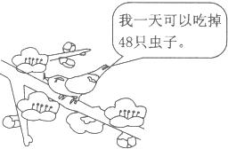

# Mathematics (Grade 3)

**ID**: 63e578c3
**难度**: medium
**题型**: short_answer

## 题目
估一估，啄木鸟一年能吃掉多少只虫子？

## 解答

**答案**: 17500

1. Step1:明确一年按365天计算
2. Step2:已知啄木鸟一天吃48只虫子，根据解析2，要用每天吃的虫子数乘一年的天数365天，即计算48×365
3. Step3:对48×365进行估算，48≈50，365≈350，50×350 = 17500，所以48×365≈17500只

## 知识点

**知识点**:
  - 整数的乘法及应用；数的估算．

---
