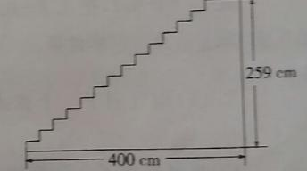

# Mathematics (Grade 3)

**ID**: 669c95d1
**难度**: medium
**题型**: short_answer

## 题目
下面是一幅楼梯图，楼梯共14阶，高259cm，每阶楼梯高多少厘米？

## 解答

**答案**: 17

1. Step1:明确已知条件，楼梯总高度为259cm，楼梯共14阶
2. Step2:因为求每阶楼梯的高度，所以用总高度除以楼梯的阶数，即259÷14
3. Step3:计算259÷14的结果为17cm

## 知识点

**知识点**:
  - --

---
