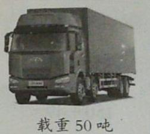

# Mathematics (Grade 3)

**ID**: 6cc1d190
**难度**: medium
**题型**: short_answer

## 题目
要运走350吨的货物，这辆汽车需要要运多少次？如果要运走480吨的货物呢？

 载重50吨

## 解答

**答案**: 7, 10

1. Step1:明确汽车载重为50吨，要运走350吨货物，计算运输次数，用货物重量除以汽车载重，即350÷50=7次
2. Step2:要运走480吨货物，同样用货物重量除以汽车载重计算运输次数，480÷50=9.6次
3. Step3:由于运输次数必须为整数，9次运不完，所以需要向上取整，得到480吨货物运输次数约为10次

## 知识点

**知识点**:
  - 

---
