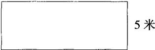

# Mathematics (Grade 3)

**ID**: 7c4fc4a2
**难度**: medium
**题型**: short_answer

## 题目
一块长方形菜地原来的面积是125平方米，宽是5米，现在的菜地长不变，宽增加到25米，扩大后的面积是多少平方米？

## 解答

**答案**: 625

1. Step1:根据原来长方形面积125平方米和宽5米，由长方形面积公式面积=长×宽，可得长为125÷5 = 25米
2. Step2:已知现在宽增加到25米，长不变为25米，根据长方形面积公式可得扩大后的面积为25×25 = 625平方米
3. Step3:或者因为长不变，原来宽是5米，现在宽是25米，25÷5 = 5，宽扩大了5倍，根据因数与积的变化规律，面积也扩大5倍，所以扩大后的面积为125×5 = 625平方米

## 知识点

**知识点**:
  - 长方形、正方形的面积．

---
