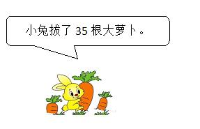

# Mathematics (Grade 3)

**ID**: 864e82ac
**难度**: medium
**题型**: short_answer

## 题目

（1）小兔吃了18根，还剩多少根大萝卜？
（2）山羊爷爷又给小兔送来25根大萝卜，现在小兔一共有多少个大萝卜？

## 解答

**答案**: 17, 42

1. Step1:已知小兔一开始拔了35根大萝卜，吃了18根，求剩下的数量，用总数减去吃掉的数量，即35 - 18 = 17根
2. Step2:已知剩下17根大萝卜，山羊爷爷又送来25根，求现在一共有的数量，用剩下的数量加上送来的数量，即17 + 25 = 42根

## 知识点

**知识点**:
  - 小学数学;数与代数;应用题;简单应用题;整数简单应用题

---
