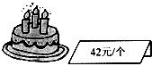

# Mathematics (Grade 3)

**ID**: 87d61815
**难度**: medium
**题型**: short_answer

## 题目
赵娜、李雪、李丽和王莹合买一个生日蛋糕送给军属张爷爷，平均每人应付多少元？

## 解答

**答案**: 10.5

1. Step1:明确问题是求把42元平均分给4个人，每人应付的钱数
2. Step2:根据“等分”除法的意义，用总钱数42除以人数4，即42÷4
3. Step3:计算42÷4的结果为10.5元

## 知识点

**知识点**:
  - 整数的除法及应用．

---
