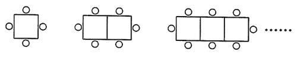

# Mathematics (Grade 3)

**ID**: 88202ac5
**难度**: medium
**题型**: short_answer

## 题目
如下图，1张桌子可以坐4人，2张桌子拼起来可以坐6人，3张桌子拼起来可以坐8人。

（1）像这样的4张桌子拼起来可以坐多少人？
（2）像这样的6张桌子拼起来可以坐多少人？
（3）如果有40人，那么需要多少张这样的桌子拼起来？

## 解答

**答案**: 10, 14, 19

1. Step1:分析题目中桌子数量和可坐人数的规律，发现每多一张桌子多坐2人，可得出坐的人数 = 桌子数×2 + 2
2. Step2:计算4张桌子拼起来可坐人数，根据上述规律可得4×2 + 2 = 10人
3. Step3:计算6张桌子拼起来可坐人数，即6×2 + 2 = 14人
4. Step4:计算40人需要的桌子数，由坐的人数 = 桌子数×2 + 2变形可得桌子数=(人数 - 2)÷2，所以(40 - 2)÷2 = 19张

## 知识点

**知识点**:
  - 小学数学;数与代数;应用题;常见的数学问题;数与形

---
