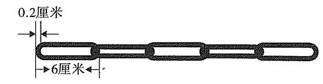

# Mathematics (Grade 3)

**ID**: 8a2a65a9
**难度**: medium
**题型**: short_answer

## 题目
用5个长是6厘米的曲别针，连成一条铁链，每个曲别针的铁丝粗0.2厘米.把这条铁链拉直后全长是多少厘米？

 0.2厘米    6厘米

## 解答

**答案**: 28.4

1. Step1:先计算 5 个曲别针不重叠时的总长度，每个曲别针长 6 厘米，所以总长度为 6×5 = 30 厘米
2. Step2:分析重叠部分，5 个曲别针相连，重叠的部分是 8 个铁丝的粗度，每个铁丝粗 0.2 厘米，所以重叠部分的长度为 0.2×8 = 1.6 厘米
3. Step3:用不重叠时的总长度减去重叠部分的长度，得到铁链拉直后的长度，即 30 - 1.6 = 28.4 厘米

## 知识点

**知识点**:
  - 第三单元验收标准检测

---
