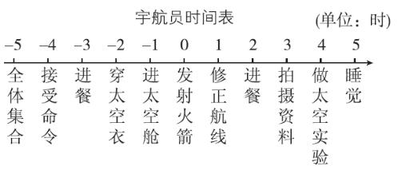

# Mathematics (Grade 3)

**ID**: 92772fc6
**难度**: medium
**题型**: short_answer

## 题目
看图回答问题。

(1)－3时表示宇航员要做什么？宇航员什么时间穿太空衣？
(2)宇航员两餐之间间隔多长时间？

## 解答

**答案**: 进餐, -2时, 5小时

1. Step1:观察图表，找到-3时对应的宇航员活动为进餐，回答(1)中－3时表示宇航员要做什么的问题
2. Step2:观察图表，找到穿太空衣对应的时间为-2时，回答(1)中宇航员什么时间穿太空衣的问题
3. Step3:观察图表，找到两次进餐对应的时间分别为-3时和2时，计算两餐间隔时间为2 - (-3) = 5小时，回答(2)宇航员两餐之间间隔多长时间的问题

## 知识点

**知识点**:
  - 小学数学;数与代数;数的认识

---
