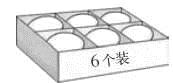

# Mathematics (Grade 3)

**ID**: 96c372fc
**难度**: medium
**题型**: short_answer

## 题目
看图列式。7盒有多少个？8盒、9盒呢？

## 解答

**答案**: 42, 48, 54

1. Step1:已知每盒有6个，求7盒的数量，用每盒个数乘以盒数，即6×7=42个
2. Step2:求8盒的数量，同样用每盒个数乘以盒数，即6×8=48个
3. Step3:求9盒的数量，用每盒个数乘以盒数，即6×9=54个
4. Step4:将7盒、8盒、9盒对应的数量42、48、54整理成列表['42', '48', '54']

## 知识点

**知识点**:
  - 小学数学;数与代数;应用题;简单应用题;整数简单应用题

---
