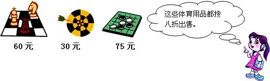

# Mathematics (Grade 3)

**ID**: 990783e3
**难度**: medium
**题型**: short_answer

## 题目
体育室到育兴商场购买了下面体育用品各1件，共需付多少钱？     

## 解答

**答案**: 132

1. Step1:计算三种体育用品的原价总和，60 + 30 + 75 = 165（元）
2. Step2:因为商品按八折出售，即现价是原价的80%，所以用原价总和乘以80%，165×80% = 132（元）

## 知识点

**知识点**:
  - 图文应用题．

---
