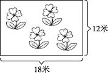

# Mathematics (Grade 3)

**ID**: a1420ec3
**难度**: medium
**题型**: short_answer

## 题目
利民小区有一个花园,如图

(1)这个花园的占地面积是多少平方米？
(2)如果每平方米种三株花,一共可以种少株？

## 解答

**答案**: 216平方米, 648株

1. Step1:根据长方形面积公式，花园长18米，宽12米，计算花园占地面积为12×18 = 216平方米
2. Step2:已知每平方米种3株花，花园面积为216平方米，计算种花总数为3×216 = 648株

## 知识点

**知识点**:
  - 小学数学;数与代数;应用题;简单应用题

---
